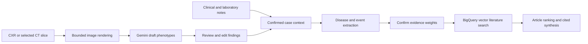

# Capricorn TB imaging research prototype

This checkout extends [terell/capricorn-tb-fork](https://github.com/terell/capricorn-tb-fork) for the existing `njms-tb-image-study` deployment. It turns a chest X-ray or selected CT slice into **draft image observations**, requires a person to review them, then combines the confirmed findings with supplied clinical notes to search PubMed Central literature and synthesize cited research evidence.

The TB upgrade is deployed and technically verified at **https://capricorn-njms-tb-image-study.web.app**. The additional $20 setup/test budget was approved; conservative reservations total $9.80, not a final provider bill. See [deployment status](docs/tb-deployment-status-2026-10-28.md) for live checks, limits and rollback.



Typing “Who are you?” returns a local introduction. Failed or nonclinical extraction stops the case workflow. Draft image findings cannot trigger literature retrieval before review and evidence-weight confirmation.

## Start the frontend locally

Requirements: Node.js 22, npm, and the ignored local environment file prepared for this checkout. From the permanent checkout:

```sh
cd /Users/xutaowang/Documents/Rutgers_work/capricorn-tb-fork/frontend
npm ci --ignore-scripts
npm start
```

The prepared development server is already running at http://localhost:3000. When starting it again in your own terminal, use the commands above and stop that terminal’s server with Ctrl+C. Sign in with `xw488@gcp.rutgers.edu`. Use port 3000 because it is an approved backend origin. Stop the local server with Ctrl+C.

The frontend uses the configured cloud backends; running it locally does not make model or literature operations free. `.env.development.local` and `.env.production.local` contain the current Firebase web configuration and function URLs. All ten actual protected endpoints, including image analysis, are configured. An unset endpoint in another checkout shows an error before sending a request. Copy `.env.example` only when configuring another checkout; retain the actual prepared local files here. No service-account key is needed.

## Supported image input

- One PNG, JPEG, WebP or uncompressed monochrome DICOM object per request.
- Chest radiographs and selected CT slices, up to 5 MiB per file and 16 million decoded pixels; preview maximum dimension 2048.
- Single-frame DICOM only. Complete CT series, archives, multi-frame, compressed/deflated or unsupported transfer syntaxes are rejected.
- DICOM signed pixels and modality rescale are applied before VOI/windowing and MONOCHROME1 inversion. CT without a supplied window uses center −600/width 1500; the applied window is recorded.
- Structured observations cover cavitation, consolidation, bilateral extent visible in this image, and miliary pattern. Each has an explicit present/absent/indeterminate/not-assessable state. Invalid model output is an error, never fabricated findings.

Use de-identified images. Only whitelisted technical DICOM metadata is sent with rendered pixels. Preview pixels remain transient browser/request data; they are not stored in chats. Reviewed text is redacted before case processing and owner-scoped chat storage. Reviewed model/modality/quality and whitelisted rendering provenance are saved beside that text. The inherited real sample files are in `frontend/research-assets/` with unverified provenance and are excluded from the public build. The text demo is a canned example, not a live vision result.

This is a research prototype. General vision model observations are not a diagnosis, TB confirmation, drug-resistance test, treatment decision or validated measure of whole-volume disease burden. Google describes general vision models as unsuitable for medical-image interpretation; engineering tests do not establish clinical accuracy. See [Google image-understanding guidance](https://docs.cloud.google.com/gemini-enterprise-agent-platform/models/capabilities/image-understanding) and [CDC diagnostic guidance](https://www.cdc.gov/tb/hcp/testing-diagnosis/clinical-and-laboratory-diagnosis.html). TB Portals access/data authorization is a separate step; see [data access](https://tbportals.niaid.nih.gov/access-data).

## Backend configuration and review artifacts

The backend uses Python 3.12 and ten protected Gen2 HTTP functions. All paid endpoints verify a current, non-revoked Firebase Google identity from the configured email allowlist before application work. Frontend requests obtain the current ID token for each request. Named Firestore database: `capricorn-dev`; allowed users can access only their own chats and presets. Feedback remains disabled.

`deploy/prepare.py` performs local file generation only. It stages complete source bundles, explicit env files, owner-scoped rules, target Hosting configuration and an upgrade review plan. Both shell wrappers call this generator; they perform no deployment.

```sh
cp deploy/config.example.toml deploy/config.local.toml
python3.12 deploy/prepare.py --config deploy/config.local.toml
```

Review `.deploy/REVIEW-PLAN.md` and `.deploy/review.json`. After the actual-configured build is reviewed, stage `frontend/build` inside `.deploy/firebase/public` before Hosting deployment; Firebase requires public assets to stay within its config/project directory. An existing output is preserved unless `--replace` is explicit, and replacement is refused if any active state, unknown file or local edit is present. Choose a fresh output directory instead of deleting deployment state. All actual env files, local config and `.deploy/` are ignored by Git.

The upgrade reuses the existing project, nine function identities, Firebase app/site, database, BigQuery datasets/connection/embedding model, source bucket, repository and build identity. It adds only the image function and runtime account `capricorn-dev-fn-10`, grants that account Vertex access plus the existing minimal Firebase verifier role, and creates only a missing `tuberculosis` specialty. No existing data loader, database creation or embedding-model replacement is part of this upgrade.

| Caller | Explicit model |
| --- | --- |
| Image, chat, lab and article scoring | `gemini-3.8-flash` |
| Disease/events, specialty detection and trial screening | `gemini-3.1-flash-lite` |
| Final synthesis | `gemini-3.1-pro-preview` |
| Existing BigQuery embedding model | `text-embedding-005` |

Model proposals were checked against [Google’s model lifecycle](https://docs.cloud.google.com/gemini-enterprise-agent-platform/models/model-versions) and [Gemini 3.8 Flash documentation](https://docs.cloud.google.com/gemini-enterprise-agent-platform/models/gemini/3-8-flash). The synthetic live image, extraction, one-candidate retrieval and final-synthesis checks passed after approval.

Functions use minimum 0, maximum 1 instance, concurrency 1 and timeout 540 seconds. The image function has 1 GiB memory; others 512 MiB. One displayed/scored article maximum and a 150 GB per-query ceiling are enforced in code. The fork's deterministic journal ranking and candidate formula `min(max(n, int(n*1.4)), 25)` are preserved. The current citation table covers only three earlier test PMIDs, so missing citation counts do not establish lack of citations. These limits are not a provider-enforced dollar cap.

## Verification and rollback

Local tests use mocks, synthetic images and a loopback Firestore emulator. They verify technical behavior, not diagnostic performance. Setup evidence and remaining deployment work are recorded in [docs/tb-setup-status.md](docs/tb-setup-status.md). Approved design: [design](docs/superpowers/specs/2026-10-28-tb-imaging-design.md); execution plan: [plan](docs/superpowers/plans/2026-10-28-tb-imaging-setup.md).

```sh
PYTHONPATH=backend python3.12 -m unittest discover -s backend/tests -v
python3.12 -m unittest discover -s deploy/tests -v
cd frontend
CI=true npm test -- --watchAll=false --runInBand
npm run build
```

For backend tests, install the pinned shared requirements from `backend/requirements-test.txt` plus `backend/capricorn-analyze-image/requirements.txt` in a Python 3.12 virtual environment first. The prepared isolated test environment is recorded in the status document.

The original checkout `/Users/xutaowang/Documents/Rutgers_work/capricorn_v2` and its active `.deploy/` are preserved as the rollback source. Deployment must first save current function descriptions/env/IAM and the previous Hosting release in a new TB ledger. Rollback restores the earlier nine sources/envs and Hosting release; the new image service can remain private with minimum zero instances. Preserve all Firestore and BigQuery data. No deletion is needed to pause local work.
