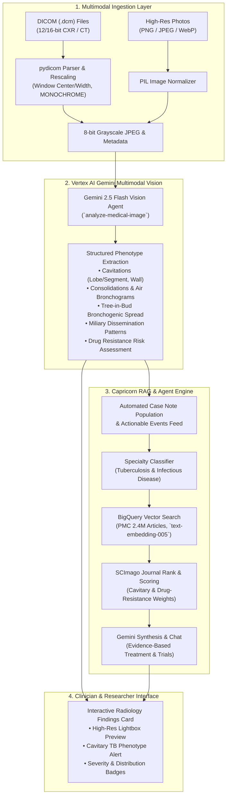

# Capricorn — Multimodal Medical Research Assistant

An AI-powered clinical decision support and medical research platform built on Google Cloud and Vertex AI. Capricorn analyzes complex clinical presentations, extracts actionable biomarkers, searches through 2.4+ million PubMed Central open access full-text articles using BigQuery vector embeddings (`text-embedding-005`), and synthesizes evidence-based regimens with **Gemini**.

Originally designed for pediatric oncology, Capricorn now features a **Multimodal Medical Imaging Pipeline** developed for the **Rutgers Health Tuberculosis & Infectious Disease Prototype**, enabling direct ingestion and analysis of **DICOM (.dcm)** files and high-resolution thoracic radiographs/CT scans alongside clinical microbiology and molecular genomics.

---

## Key Capabilities

- 🫁 **Multimodal Thoracic Imaging (TB Focus)**: Native parsing of 12/16-bit DICOM radiographs and CT scans (`pydicom`), dynamic window center/width contrast normalization, and expert thoracic phenotyping via **Vertex AI Gemini 2.5 Flash Multimodal Vision** (cavitary lung pathology, consolidations, tree-in-bud opacities, and miliary patterns).
- 🧬 **Multi-Specialty Persona Architecture**: Firestore-backed specialty personas (`tuberculosis`, `pediatric-oncology`, `adult-oncology`, `cardiology`, `neurology`, `gastroenterology`, `general-medicine`) with automated specialty classification and evidence-weighting rubrics.
- ⚡ **High-Performance Literature Retrieval**: Disease-anchored BigQuery `VECTOR_SEARCH` against 2.4 million PubMed Central full-text articles with real-time SSE progress streaming and $O(1)$ in-memory SCImago Journal Rank (SJR) impact scoring.
- 🩺 **Clinical Trials & Evidence Synthesis**: Automatic screening of active ClinicalTrials.gov studies and Gemini synthesis of individualized therapy recommendations.

---

## Architecture Overview



The application consists of:
- **Frontend**: React application running on Node 18 and Express, deployed on **Google Cloud Run**
- **Backend Microservices**: 10 Gen2 Cloud Functions and Cloud Run services in `us-central1`
- **Database**: Firestore (`capricorn-prod`) for chat sessions and specialty personas, BigQuery for PMC vector embeddings and SCImago journal rankings
- **AI Services**: Vertex AI Gemini 2.5 Flash (Vision & fast scoring), Gemini 3.1 Flash Lite (specialty detection), Gemini 3.1 Pro (final synthesis), and Google Cloud DLP (demographic redaction)

---

## Tuberculosis & Multimodal Imaging Pipeline (Rutgers Health)

In Phase 1 of the Rutgers Health Infectious Disease & Data Science collaboration, research data focuses heavily on medical imaging from the NIH/NIAID TB Portals. Capricorn integrates this imaging data directly into the diagnostic loop:

1. **DICOM Ingestion**: Supports `.dcm` files with varying bit depths (12-bit/16-bit stored), extracting DICOM header metadata (modality, view position, body part, study date) and applying window center/width linear rescale transforms.
2. **Thoracic Feature Extraction**: Gemini 2.5 Flash evaluates:
   - **Cavitation**: Identifies apical cavities, wall thickness, and fluid levels (critical biomarkers for bacillary load and delayed sputum conversion).
   - **Parenchymal Disease**: Quantifies airspace consolidation, air bronchograms, and ground-glass opacities.
   - **Bronchogenic & Hematogenous Spread**: Detects branching tree-in-bud opacities and diffuse 1–3 mm miliary micronodules.
   - **Laterality & Severity**: Generates quantitative zone involvement and overall severity grade.
3. **Automated Evidence Weighting**: Radiologic phenotypes (e.g. *"Right upper lobe cavitation"*, *"Tree-in-bud opacities"*) are extracted as actionable events, driving BigQuery literature ranking to prioritize studies with identical imaging phenotypes and matching resistance profiles (e.g., *rpoB* S531L rifampicin resistance, BPaL/BPaLM trials).
4. **Interactive UI**: Clinicians can upload chest images via the `Upload CXR / DICOM` modal, preview the radiograph in an interactive lightbox, and immediately see detected phenotypes populated into the diagnostic workspace.
5. **Sample Datasets**: Built-in test files are provided in `frontend/public/`:
   - `sample_tb_cxr.jpg`: High-resolution PA chest radiograph demonstrating bilateral cavitary tuberculosis.
   - `sample_tb_cxr.dcm`: Valid DICOM radiograph for testing native DICOM ingestion.

---

## Prerequisites

- Google Cloud Platform account with billing enabled (`onboarding-sandbox-477121`)
- gcloud CLI installed and authenticated
- Node.js 18 or higher (for local frontend development)
- Docker / Cloud Build (for container deployments)
- SendGrid account (optional, for email feedback notifications)

---

## One-Command Deployment

To deploy the entire multimodal architecture to Google Cloud:

```bash
# 1. Authenticate with gcloud
gcloud auth login terellmoore@terellmoore.altostrat.com

# 2. Run the automated deployment script
./deploy-tb-multimodal.sh
```

This script automatically:
1. Seeds all clinical specialty personas (including Tuberculosis) into Firestore (`capricorn-prod`).
2. Deploys the `analyze-medical-image` Gen2 Cloud Function with `pydicom` and Gemini 2.5 Flash.
3. Builds the frontend container with Cloud Build (`gcr.io/onboarding-sandbox-477121/medical-assistant:latest`).
4. Deploys the web application to Cloud Run with public invoker access.

---

## Setup Instructions

### 1. Firestore Database Setup

Create a Firestore database for storing chat conversations.

**Prerequisites:**
- Install gcloud CLI: https://cloud.google.com/sdk/docs/install
- Authenticate: `gcloud auth login`
- Set project: `gcloud config set project YOUR_GCP_PROJECT_ID`

**1. Set project variables and enable APIs:**

First, link Firebase to your existing Google Cloud project:

**Link Firebase to Your Google Cloud Project:**
- Go to https://console.firebase.google.com/
- Click "Create a new Firebase project"
- Click "Add Firebase to Google Cloud project"
- Select your existing Google Cloud project from the dropdown
- Follow the remaining setup steps (you can skip Google Analytics if not needed)
- Verify the project is correctly linked by checking the project ID matches your GCP project

After linking Firebase, continue with the setup:

Choose a location for your Firestore database:
- Multi-region options: `nam5` (US), `eur3` (Europe)
- Regional options: `us-central1`, `europe-west1`, etc.
- Full list: https://firebase.google.com/docs/firestore/locations

```bash
# Set your configuration values
export PROJECT_ID="YOUR_GCP_PROJECT_ID"
export DATABASE_ID="YOUR_DATABASE_ID"  # e.g., "capricorn-prod", "capricorn-dev"
export DATABASE_LOCATION="YOUR_LOCATION"  # e.g., "nam5" for US multi-region
export FUNCTION_REGION="YOUR_FUNCTION_REGION"  # e.g., "us-central1" for Cloud Functions deployment
export VERTEX_REGION="global"  # Use "global" for Vertex AI/Gemini access

# Enable required APIs
gcloud services enable \
  firestore.googleapis.com \
  cloudfunctions.googleapis.com \
  cloudbuild.googleapis.com \
  run.googleapis.com \
  dlp.googleapis.com \
  aiplatform.googleapis.com \
  bigquery.googleapis.com \
  --project=$PROJECT_ID

# Grant Cloud Build service account the required permissions
PROJECT_NUMBER=$(gcloud projects describe $PROJECT_ID --format='value(projectNumber)')
gcloud projects add-iam-policy-binding $PROJECT_ID \
  --member="serviceAccount:${PROJECT_NUMBER}-compute@developer.gserviceaccount.com" \
  --role="roles/cloudbuild.builds.builder"
```

**5. Grant Cloud Functions service account required permissions:**

Cloud Functions use the default compute service account which needs access to various services:

```bash
# Get the service account email
SERVICE_ACCOUNT="${PROJECT_NUMBER}-compute@developer.gserviceaccount.com"

# Grant Firestore access (for chat storage)
gcloud projects add-iam-policy-binding $PROJECT_ID \
  --member="serviceAccount:${SERVICE_ACCOUNT}" \
  --role="roles/datastore.user"

# Grant BigQuery access (for querying embeddings and journal data)
gcloud projects add-iam-policy-binding $PROJECT_ID \
  --member="serviceAccount:${SERVICE_ACCOUNT}" \
  --role="roles/bigquery.jobUser"

gcloud projects add-iam-policy-binding $PROJECT_ID \
  --member="serviceAccount:${SERVICE_ACCOUNT}" \
  --role="roles/bigquery.dataViewer"

# Grant BigQuery connection user access (required for text embeddings)
gcloud projects add-iam-policy-binding $PROJECT_ID \
  --member="serviceAccount:${SERVICE_ACCOUNT}" \
  --role="roles/bigquery.connectionUser"

# Grant DLP access (for PII redaction)
gcloud projects add-iam-policy-binding $PROJECT_ID \
  --member="serviceAccount:${SERVICE_ACCOUNT}" \
  --role="roles/dlp.user"

# Grant Vertex AI access (for Gemini models and embeddings)
gcloud projects add-iam-policy-binding $PROJECT_ID \
  --member="serviceAccount:${SERVICE_ACCOUNT}" \
  --role="roles/aiplatform.user"
```

These permissions allow the Cloud Functions to:
- Read/write to Firestore for storing chat conversations
- Query BigQuery for article embeddings and journal data
- Use DLP API for redacting sensitive information
- Access Vertex AI for Gemini models and text embeddings

**6. Create the database:**
```bash
# Create the Firestore database
gcloud firestore databases create \
  --database=$DATABASE_ID \
  --location=$DATABASE_LOCATION \
  --project=$PROJECT_ID
```

**7. After creating the database, update the frontend configuration:**
```bash
cd frontend
cp .env.example .env
# Edit .env and set:
# REACT_APP_FIREBASE_DATABASE_ID=your-database-id
```

**Note**: Backend configuration will be handled in the next section using the setup script.

**8. Configure and deploy Firestore security rules:**

First, update the `firebase.json` to specify the database ID:

```bash
cd frontend

# Update firebase.json to include the database ID
# The file should have this structure:
cat > firebase.json << EOF
{
  "hosting": {
    "site": "<app-nickname-in-step-4.1.2 Find Your Configuration>",
    "public": "build",
    "ignore": [
      "firebase.json",
      "**/.*",
      "**/node_modules/**"
    ],
    "rewrites": [
      {
        "source": "**",
        "destination": "/index.html"
      }
    ]
  },
  "firestore": {
    "rules": "firestore.rules",
    "database": "$DATABASE_ID"
  }
}
EOF
```

Then deploy the security rules to the specific database:

```bash
firebase deploy --only firestore:rules --project $PROJECT_ID
```

The security rules in `firestore.rules` allow authenticated users to read/write their own chats:
```
match /chats/{userId}/conversations/{document=**} {
  allow read, write: if request.auth != null && request.auth.uid == userId;
}
```

### 2. BigQuery Setup

The application requires BigQuery datasets with PubMed article embeddings and metadata. Set these up before deploying Cloud Functions.

#### 2.1 Create Text Embedding Model

The application uses BigQuery ML to create text embeddings for searching PubMed articles. Create the embedding model:

```bash
# Create the model dataset and text embedding model
bq query --use_legacy_sql=false \
"CREATE SCHEMA IF NOT EXISTS \`$PROJECT_ID.model\`
OPTIONS(location='US');

CREATE MODEL IF NOT EXISTS \`$PROJECT_ID.model.textembed\`
REMOTE WITH CONNECTION DEFAULT
OPTIONS(endpoint='text-embedding-005');"

# Verify the model was created
bq show --model $PROJECT_ID:model.textembed
```

This creates:
- A dataset called `model` in the US location
- A text embedding model using Google's `text-embedding-005` endpoint

#### 2.2 Journal Impact Factor Dataset Setup

The application uses journal impact factor data (SJR scores) to rank articles. The repository includes a pre-downloaded SCImago Journal Rank CSV file.

**Create the journal_rank dataset:**

```bash
# Create the journal_rank dataset
bq query --use_legacy_sql=false \
"CREATE SCHEMA IF NOT EXISTS \`$PROJECT_ID.journal_rank\`
OPTIONS(location='US');"
```

**Load the journal data into BigQuery:**

```bash
# Install required dependencies
pip install google-cloud-bigquery

# Navigate to the function directory and run the loading script
cd backend/capricorn-retrieve-full-articles
python load_journal_data_to_bq.py \
  --project-id $PROJECT_ID \
  --dataset-id journal_rank \
  --table-id scimagojr_2024 \
  --csv-file scimagojr_2024.csv
```

This script will:
- Create a `journal_rank` dataset if it doesn't exist
- Load the SCImago journal data into a table named `scimagojr_2024`
- Display sample data and confirm successful loading

**Verify the data loaded correctly:**
```bash
# Check the record count (should show ~29,000+ journals)
bq query --use_legacy_sql=false \
"SELECT COUNT(*) as journal_count FROM \`$PROJECT_ID.journal_rank.scimagojr_2024\`"
```

### 3. Cloud Functions Setup

Each Cloud Function needs to be deployed with the appropriate environment variables:

#### 3.1 Create Backend Configuration

Use the provided setup script to create all `.env.yaml` files:

```bash
# If you've already set the environment variables in section 1, the script will use them
# Otherwise, it will prompt you for the required values
./setup-backend-config.sh
```

This creates `.env.yaml` files for all Cloud Functions:
- `backend/capricorn-chat/.env.yaml`
- `backend/capricorn-redact-sensitive-info/.env.yaml`
- `backend/capricorn-process-lab/.env.yaml`
- `backend/capricorn-retrieve-full-articles/.env.yaml`
- `backend/capricorn-final-analysis/.env.yaml`
- `backend/capricorn-feedback/.env.yaml`
- `backend/pubmed-search-tester-extract-disease/.env.yaml`
- `backend/pubmed-search-tester-extract-events/.env.yaml`

**Note**: The `.env.yaml` files are already in `.gitignore` to prevent committing sensitive data.

#### 3.2 Deploy Cloud Functions

Deploy each function with its configuration:

```bash
# Deploy all functions
cd backend

# Redact Sensitive Info (DLP + lightweight Gemini call for date parsing)
cd capricorn-redact-sensitive-info
gcloud functions deploy redact-sensitive-info \
  --gen2 \
  --runtime=python312 \
  --region=$FUNCTION_REGION \
  --source=. \
  --entry-point=redact_sensitive_info \
  --trigger-http \
  --allow-unauthenticated \
  --cpu=1 \
  --memory=512Mi \
  --timeout=300s \
  --max-instances=100 \
  --min-instances=1 \
  --concurrency=1 \
  --env-vars-file=.env.yaml

# Process Lab (Gemini PDF parsing - network I/O bound, not CPU)
cd ../capricorn-process-lab
gcloud functions deploy process-lab \
  --gen2 \
  --runtime=python313 \
  --region=$FUNCTION_REGION \
  --source=. \
  --entry-point=process_lab \
  --trigger-http \
  --allow-unauthenticated \
  --cpu=1 \
  --memory=1Gi \
  --timeout=3600s \
  --max-instances=100 \
  --min-instances=1 \
  --concurrency=80 \
  --env-vars-file=.env.yaml

# Retrieve Full Articles (BQ vector search + streaming Gemini analysis of ~15 articles)
cd ../capricorn-retrieve-full-articles
gcloud functions deploy retrieve-full-articles-live-pmc-text-embedding-005 \
  --gen2 \
  --runtime=python312 \
  --region=$FUNCTION_REGION \
  --source=. \
  --entry-point=retrieve_full_articles \
  --trigger-http \
  --allow-unauthenticated \
  --cpu=1 \
  --memory=2Gi \
  --timeout=3600s \
  --max-instances=100 \
  --min-instances=1 \
  --concurrency=1 \
  --env-vars-file=.env.yaml

# Final Analysis (BQ article fetch + single large Gemini prompt)
cd ../capricorn-final-analysis
gcloud functions deploy capricorn-final-analysis \
  --gen2 \
  --runtime=python312 \
  --region=$FUNCTION_REGION \
  --source=. \
  --entry-point=final_analysis \
  --trigger-http \
  --allow-unauthenticated \
  --cpu=1 \
  --memory=2Gi \
  --timeout=3600s \
  --max-instances=100 \
  --min-instances=1 \
  --concurrency=1 \
  --env-vars-file=.env.yaml

# Chat (single streaming Gemini call)
cd ../capricorn-chat
gcloud functions deploy chat \
  --gen2 \
  --runtime=python312 \
  --region=$FUNCTION_REGION \
  --source=. \
  --entry-point=chat \
  --trigger-http \
  --allow-unauthenticated \
  --cpu=1 \
  --memory=1Gi \
  --timeout=3600s \
  --max-instances=100 \
  --concurrency=1 \
  --env-vars-file=.env.yaml

# Feedback (sends email via SendGrid - minimal resources)
cd ../capricorn-feedback
gcloud functions deploy send-feedback-email \
  --gen2 \
  --runtime=python39 \
  --region=$FUNCTION_REGION \
  --source=. \
  --entry-point=send_feedback_email \
  --trigger-http \
  --allow-unauthenticated \
  --cpu=1 \
  --memory=256Mi \
  --timeout=300s \
  --max-instances=100 \
  --concurrency=80 \
  --env-vars-file=.env.yaml

# Extract Disease (single Gemini call)
cd ../pubmed-search-tester-extract-disease
gcloud functions deploy extract-disease \
  --gen2 \
  --runtime=python312 \
  --region=$FUNCTION_REGION \
  --source=. \
  --entry-point=extract_disease \
  --trigger-http \
  --allow-unauthenticated \
  --cpu=1 \
  --memory=512Mi \
  --timeout=600s \
  --max-instances=100 \
  --concurrency=1 \
  --env-vars-file=.env.yaml

# Extract Events (single Gemini call)
cd ../pubmed-search-tester-extract-events
gcloud functions deploy extract-events \
  --gen2 \
  --runtime=python312 \
  --region=$FUNCTION_REGION \
  --source=. \
  --entry-point=extract_events \
  --trigger-http \
  --allow-unauthenticated \
  --cpu=1 \
  --memory=512Mi \
  --timeout=600s \
  --max-instances=100 \
  --concurrency=1 \
  --env-vars-file=.env.yaml
```

#### 3.3 Collect Function URLs and Update Frontend

After deploying all functions, collect their URLs and update the frontend API configuration.

**IMPORTANT:** Each Cloud Function is deployed as its own Cloud Run service with a unique URL.
The frontend `api.js` has endpoints for all 10 backend microservices — every one of them must be
configured to point to your project's function URLs.

| Service Name | Source Directory | Runtime / Model | Purpose |
|---|---|---|---|
| `analyze-medical-image` | `backend/capricorn-analyze-image` | Python 3.12 / Gemini 2.5 Flash | **NEW:** DICOM parsing (`pydicom`) & thoracic TB phenotyping |
| `detect-specialty` | `backend/capricorn-detect-specialty` | Python 3.12 / Gemini 3.1 Flash Lite | Automated clinical specialty classification |
| `extract-disease` | `backend/pubmed-search-tester-extract-disease` | Python 3.12 / Gemini 3.1 Flash Lite | Primary disease / condition extraction |
| `extract-events` | `backend/pubmed-search-tester-extract-events` | Python 3.12 / Gemini 3.1 Flash Lite | Actionable clinical, radiographic, and genomic event extraction |
| `retrieve-full-articles-live-pmc-text-embedding-005` | `backend/capricorn-retrieve-full-articles` | Python 3.12 / Gemini 2.5 Flash | PMC vector search, in-memory SJR scoring, and real-time SSE progress streaming |
| `capricorn-final-analysis` | `backend/capricorn-final-analysis` | Python 3.12 / Gemini 3.1 Pro | Evidence synthesis & ClinicalTrials.gov study matching |
| `chat` | `backend/capricorn-chat` | Python 3.12 / Gemini 3.1 Pro | Interactive conversational follow-up with Firestore history |
| `redact-sensitive-info` | `backend/capricorn-redact-sensitive-info` | Python 3.12 / Cloud DLP | De-identification and PII redaction |
| `process-lab` | `backend/capricorn-process-lab` | Python 3.12 / Gemini 3.1 Flash Lite | Genomic & clinical laboratory report PDF parsing |
| `send-feedback-email` | `backend/capricorn-feedback` | Python 3.12 / SendGrid | Clinician feedback webhook |

```bash
# Navigate back to project root
cd ../..

# Use the FUNCTION_REGION from section 1 or set it now
export REGION=$FUNCTION_REGION

# Collect all function URLs
echo "Collecting Cloud Function URLs..."
REDACT_URL=$(gcloud functions describe redact-sensitive-info --region=$REGION --format='value(serviceConfig.uri)')
PROCESS_LAB_URL=$(gcloud functions describe process-lab --region=$REGION --format='value(serviceConfig.uri)')
RETRIEVE_ARTICLES_URL=$(gcloud functions describe retrieve-full-articles-live-pmc-text-embedding-005 --region=$REGION --format='value(serviceConfig.uri)')
FINAL_ANALYSIS_URL=$(gcloud functions describe capricorn-final-analysis --region=$REGION --format='value(serviceConfig.uri)')
CHAT_URL=$(gcloud functions describe chat --region=$REGION --format='value(serviceConfig.uri)')
FEEDBACK_URL=$(gcloud functions describe send-feedback-email --region=$REGION --format='value(serviceConfig.uri)')
EXTRACT_DISEASE_URL=$(gcloud functions describe extract-disease --region=$REGION --format='value(serviceConfig.uri)')
EXTRACT_EVENTS_URL=$(gcloud functions describe extract-events --region=$REGION --format='value(serviceConfig.uri)')
DETECT_SPECIALTY_URL=$(gcloud functions describe detect-specialty --region=$REGION --format='value(serviceConfig.uri)')
ANALYZE_IMAGE_URL=$(gcloud functions describe analyze-medical-image --region=$REGION --format='value(serviceConfig.uri)')

# Verify all URLs were collected
echo ""
echo "=== Collected URLs ==="
echo "REDACT_URL=$REDACT_URL"
echo "PROCESS_LAB_URL=$PROCESS_LAB_URL"
echo "RETRIEVE_ARTICLES_URL=$RETRIEVE_ARTICLES_URL"
echo "FINAL_ANALYSIS_URL=$FINAL_ANALYSIS_URL"
echo "CHAT_URL=$CHAT_URL"
echo "FEEDBACK_URL=$FEEDBACK_URL"
echo "EXTRACT_DISEASE_URL=$EXTRACT_DISEASE_URL"
echo "EXTRACT_EVENTS_URL=$EXTRACT_EVENTS_URL"
echo "DETECT_SPECIALTY_URL=$DETECT_SPECIALTY_URL"
echo "ANALYZE_IMAGE_URL=$ANALYZE_IMAGE_URL"
echo "======================"
echo ""

# Update ALL hardcoded URLs in frontend/src/utils/api.js
sed -i.bak "s|https://retrieve-full-articles[^\`'\"]*|$RETRIEVE_ARTICLES_URL|g" frontend/src/utils/api.js
sed -i.bak "s|https://chat-[^\`'\"]*\.a\.run\.app|$CHAT_URL|g" frontend/src/utils/api.js
sed -i.bak "s|https://[^\`'\"]*redact-sensitive-info[^\`'\"]*|$REDACT_URL|g" frontend/src/utils/api.js
sed -i.bak "s|https://extract-disease-[^\`'\"]*|$EXTRACT_DISEASE_URL|g" frontend/src/utils/api.js
sed -i.bak "s|https://extract-events-[^\`'\"]*|$EXTRACT_EVENTS_URL|g" frontend/src/utils/api.js
sed -i.bak "s|https://final-analysis-[^\`'\"]*|$FINAL_ANALYSIS_URL|g" frontend/src/utils/api.js
sed -i.bak "s|https://capricorn-final-analysis-[^\`'\"]*|$FINAL_ANALYSIS_URL|g" frontend/src/utils/api.js
sed -i.bak "s|https://send-feedback-email-[^\`'\"]*|$FEEDBACK_URL|g" frontend/src/utils/api.js
sed -i.bak "s|https://process-lab-[^\`'\"]*|$PROCESS_LAB_URL|g" frontend/src/utils/api.js
sed -i.bak "s|https://detect-specialty-[^\`'\"]*|$DETECT_SPECIALTY_URL|g" frontend/src/utils/api.js
sed -i.bak "s|https://analyze-medical-image-[^\`'\"]*|$ANALYZE_IMAGE_URL|g" frontend/src/utils/api.js

# Clean up .bak files
rm -f frontend/src/utils/api.js.bak

echo "✓ Updated ALL 10 function URLs in frontend/src/utils/api.js"
echo ""
echo "NEXT: Rebuild and redeploy the frontend container (see Section 5)"
```

### 4. Frontend Configuration

#### 4.1 Get Firebase Configuration Values

1. **Access Firebase Console**:
   - Go to [Firebase Console](https://console.firebase.google.com)
   - Create a new project or select your existing GCP project
   - If creating new, link it to your GCP project when prompted

2. **Find Your Configuration**:
   - Click the gear icon ⚙️ → "Project settings"
   - Scroll down to "Your apps" section
   - If no app exists, click "Add app" → Choose Web (</>)
   - Register your app with a nickname (e.g., "capricorn-medical")
   - You'll see your Firebase configuration:
   ```javascript
   const firebaseConfig = {
     apiKey: "...",              // → REACT_APP_FIREBASE_API_KEY
     authDomain: "...",          // → REACT_APP_FIREBASE_AUTH_DOMAIN
     projectId: "...",           // → REACT_APP_FIREBASE_PROJECT_ID
     storageBucket: "...",       // → REACT_APP_FIREBASE_STORAGE_BUCKET
     messagingSenderId: "...",   // → REACT_APP_FIREBASE_MESSAGING_SENDER_ID
     appId: "..."                // → REACT_APP_FIREBASE_APP_ID
   };
   ```

#### 4.2 Create Environment Configuration

```bash
cd frontend

# Create .env file (already in .gitignore)
cat > .env << EOF
REACT_APP_FIREBASE_API_KEY=YOUR_FIREBASE_API_KEY
REACT_APP_FIREBASE_AUTH_DOMAIN=YOUR_PROJECT_ID.firebaseapp.com
REACT_APP_FIREBASE_PROJECT_ID=YOUR_PROJECT_ID
REACT_APP_FIREBASE_STORAGE_BUCKET=YOUR_PROJECT_ID.appspot.com
REACT_APP_FIREBASE_MESSAGING_SENDER_ID=YOUR_MESSAGING_SENDER_ID
REACT_APP_FIREBASE_APP_ID=YOUR_APP_ID
REACT_APP_FIREBASE_DATABASE_ID=YOUR_DATABASE_ID
EOF
```

Replace the placeholders with your actual values from the Firebase configuration. Use the `DATABASE_ID` you created in section 1 (e.g., "capricorn-prod")

#### 4.3 Update Firebase Hosting Configuration

Update `firebase.json` with your project ID:
```bash
# Get the project ID from the .env file
PROJECT_ID=$(grep REACT_APP_FIREBASE_PROJECT_ID .env | cut -d '=' -f2)

# Update firebase.json with the project ID or app nickname you specified in 2. Find Your Configuration
sed -i.bak "s|\"site\": \".*\"|\"site\": \"$PROJECT_ID\"|" firebase.json

echo "✓ Updated firebase.json with site name: $PROJECT_ID"
```

#### 4.4 Configure Firebase Authentication

Before deploying, you need to configure Firebase Authentication:

1. **Enable Authentication Providers**:
   - Go to [Firebase Console](https://console.firebase.google.com)
   - Select your project
   - Navigate to "Authentication" → "Sign-in method"
   
   **Enable Google Authentication:**
   - Click on "Google" provider
   - Toggle "Enable" to ON
   - Select a support email for the project
   - Click "Save"
   
   **Enable Anonymous Authentication:**
   - Click on "Anonymous" provider
   - Toggle "Enable" to ON
   - Click "Save"
   
   This allows users to either sign in with their Google account or use the app anonymously.

2. **Add Authorized Domains**:
   - In "Authentication" → "Settings" tab (or Identity Platform settings)
   - Under "Authorized domains", ensure the following are present:
     - `localhost` (for local development)
     - `medical-assistant-djejr2bj2q-uc.a.run.app` (Cloud Run production domain)
     - `medical-assistant-190811640519.us-central1.run.app` (Cloud Run regional domain)
     - `onboarding-sandbox-477121.firebaseapp.com`
     - `onboarding-sandbox-477121.web.app`

   **Important**: Any domain where your app is hosted must be added to this list, otherwise Google popup authentication will fail with an `auth/unauthorized-domain` error.

3. **Configure OAuth Consent Screen**:
   - Choose "External" (or "Internal" if using Workspace)
   - Fill in the application title (e.g. "Capricorn Medical Assistant") and support email
   - Add your authorized domains
   - Save configuration

### 5. Deploy Frontend to Google Cloud Run (Recommended)

In production, the frontend is packaged as a Docker container running an Express static server on Node 18, deployed to Google Cloud Run:

1. **Build Container with Cloud Build**:
   ```bash
   gcloud builds submit frontend \
     --project="onboarding-sandbox-477121" \
     --tag="gcr.io/onboarding-sandbox-477121/medical-assistant:latest"
   ```

2. **Deploy Container to Cloud Run**:
   ```bash
   gcloud run deploy medical-assistant \
     --image="gcr.io/onboarding-sandbox-477121/medical-assistant:latest" \
     --platform=managed \
     --region="us-central1" \
     --project="onboarding-sandbox-477121" \
     --port=8080 \
     --memory=512Mi \
     --cpu=1
   ```

3. **Grant Public Invoker Access**:
   ```bash
   gcloud run services add-iam-policy-binding medical-assistant \
     --region="us-central1" \
     --project="onboarding-sandbox-477121" \
     --member="allUsers" \
     --role="roles/run.invoker"
   ```

### 6. Alternative: Deploy to Firebase Hosting

If you prefer hosting the static React bundle directly on Firebase Hosting:

```bash
cd frontend
npm install
npm run build
firebase deploy --only hosting --project $PROJECT_ID
```
