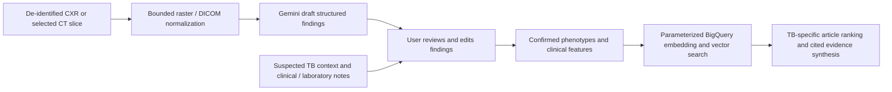

# TB imaging fork setup — design and cloud-change review

Status: implementation design approved by the user in chat on October 28,
2026. Cloud deployment and additional spending remain subject to the final
review after the local implementation and checks are ready.
Date: October 28, 2026 (America/New_York).

## Goal and confirmed scope

Set up `https://github.com/terell/capricorn-tb-fork` for the existing
`njms-tb-image-study` project. The user selected chest radiographs and selected
CT images/slices for the first version. Complete CT-series ingestion and 3D
volume analysis are outside this first release.

Repository inspected at commit
`b80b609fbda310d59fbe729bd7834f2d0e9fa86a` in
`/private/tmp/capricorn-tb-fork-inspect-20261028`. It is a public repository;
the connected GitHub account has pull access and no push permission. No push
or remote publication of source is required. No cloud changes or model calls
have been made for this new phase.

The original working directory, active `.deploy/` ledger, local config and
rollback sources remain preserved. Implementation will use a separate local
checkout of the requested fork, on `codex/tb-imaging-setup`, rather than change
the original repository's remote or discard its uncommitted work. Proposed
permanent checkout: `/Users/xutaowang/Documents/Rutgers_work/capricorn-tb-fork`.

## Approaches considered

| Approach | Benefit | Trade-off |
| --- | --- | --- |
| Upgrade the existing deployment from the TB fork (recommended) | Reuses Firebase, current URL, protected runtime identities, database and BigQuery resources; smallest additional infrastructure | Existing function code and frontend release change together; retain source/build snapshots and Hosting version for rollback |
| Deploy a separate TB stack in the same project | Keeps the current live application independently available | Additional Hosting/database/function identities and more deployment maintenance |
| Local-only research prototype | Fastest route for inspecting image drafts and UI | Hosted application remains unchanged; cloud model/query calls still cost money |

The recommendation is an upgrade at the current application URL after local
checks pass. Existing user data and existing specialty documents are preserved.
Only a missing `tuberculosis` specialty is created; collisions are inspected
rather than overwritten. The original nine runtime identities retain their
current scoped permissions.

## What the fork already contains

- `backend/capricorn-analyze-image/main.py`: one-file image endpoint, raster and
  DICOM conversion, Gemini request, JSON findings and preview response.
- `frontend/src/components/Modal/ImageInputModal.js`: DICOM/raster upload UI.
- `frontend/src/components/MainPanel/RadiologyFindingsCard.js`: image preview and
  phenotype display.
- `backend/specialties/tuberculosis.json`: TB-specific event and scoring persona.
- The upload handler currently appends the generated report to case notes;
  existing text extraction then feeds the literature search. The fork does not
  replace text event extraction with a complete CT vision agent.
- Article scoring uses a deterministic journal-score lookup rather than sending
  the entire journal-ranking list to the model. Preserve this improvement and
  the fork's candidate-pool formula, `min(max(n, int(n * 1.4)), 25)`.
  A development display cap of one therefore scores one candidate.

## Confirmed problems to address

1. Deployment script hardcodes another project/database. It configures an image
   function with min 1/max 100 instances and concurrency 80. Do not execute it
   against either project as written.
2. Image and existing endpoints lack the Firebase application guard previously
   added to our first deployment. Frontend URLs are hardcoded and requests do
   not attach current Firebase ID tokens. Port the tested protection/config
   layer while preserving the fork's imaging and faster scoring changes.
3. Gemini 1.5 Pro is retired. The fork actually codes Gemini 2.5 Flash, also
   retired on the relevant Google Cloud platform. Configure supported models
   explicitly; do not silently fall back to another project or model.
4. DICOM conversion omits modality rescale slope/intercept and has no explicit
   multi-frame/series restriction, dimension limits or decoded-pixel budget.
5. Invalid model JSON is turned into fabricated fallback events, then returned
   as success. Findings have no enforced schema or uncertainty state. Reject
   invalid output; never fabricate a successful phenotype.
6. Upload handling puts unreviewed model text into clinical notes immediately.
   The card can label an uncertain result as "No Cavitation" or "Cavitary TB"
   and the prompt invites resistance/treatment conclusions from an image.
7. The sample CXR button loads `presetTBFindings` directly; it does not call the
   vision endpoint. A sample display is not evidence of live image inference.
   Bundled real-image provenance/de-identification has not been established.
8. The previously reported "Who are you?" problem remains: arbitrary strings
   enter the case workflow, failed disease/event extraction is treated as
   success, and idle UI stages can show green checkmarks.
9. The fork still has oncology-specific final-report wording, raw SQL text
   interpolation, verbose sensitive logs, and overwrite-based specialty seeds.
   Apply the already-tested request/SQL/logging/data-preservation fixes to the
   fork and make the TB report wording fit the supplied condition.

All 21 Python source files parse. This is a static check, not a dependency,
security or functional pass. No credential-like values were printed during
inspection; a narrow source scan found no Google API-key or SendGrid-key
patterns in backend/frontend source.

## Application flow

### Input and DICOM handling

- Accept JPEG, PNG and WebP images, and supported single-frame chest DICOM
  objects. One uploaded image/slice per analysis; reject archives, complete
  series, multi-frame DICOM and unsupported transfer syntaxes with clear errors.
- Preserve 12/16-bit and signed pixels through modality rescale, VOI/windowing
  and MONOCHROME handling. Apply a documented lung-window default for a CT
  slice without a supplied window, with the applied window recorded.
- Apply request/base64 bounds before decoding and image/pixel bounds before
  allocation. Initial raw-file limit: 5 MiB; decoded pixel cap: 16 megapixels;
  inference preview maximum dimension: 2048 pixels. Never label resized preview
  dimensions as original dimensions.
- Send rendered pixels and only whitelisted technical metadata to the model;
  omit patient identifiers and free-text DICOM descriptions. Do not log file
  names, pixels, patient/case text, model output or auth headers.
- Input images are transient browser/request data. Do not publish uploads or
  retain raw pixels in Firestore. Store reviewed findings and minimal technical
  provenance with the existing owner-scoped chat data.
- Keep the repository's unverified real sample assets out of the public release.
  Use clearly labeled synthetic fixtures for engineering tests. Any canned
  example is labeled as an example, never as a live model result.

### Structured findings and review

Use a validated response schema covering modality, technical quality,
cavitation, consolidation, visible bilateral extent, miliary pattern and
additional thoracic observations. A finding has an explicit state: present,
absent, indeterminate or not assessable, plus optional location and description.
Unknown fields stay unknown. Record model ID and preprocessing provenance.
Do not equate model certainty with a calibrated clinical probability.

The user sees draft findings and can edit their phenotype text before an
explicit confirmation. Only confirmed present findings become positive search
features. Missing/indeterminate findings do not turn into negative assertions.
Selected slices do not establish whole-volume extent or a volumetric burden.
No automated TB confirmation, resistance classification or treatment selection
is inferred from pixels. Clinical/laboratory facts supplied by the user remain
separate from image observations.

This is a research prototype. Google documents that its general image models
are not suitable for interpreting medical images. CDC guidance also distinguishes
radiographic suspicion from confirmed TB and requires laboratory evidence for
resistance assessment. Technical deployment checks will not establish clinical
accuracy or justify using model findings for patient-care decisions.

### Case extraction and literature search

- Handle a simple app-introduction question locally without case initialization,
  persona generation or literature work. Reject other non-case input clearly.
- Validate semantic extraction success, including empty/no-disease/no-events
  results, before creating a case or displaying evidence weights. Use a typed
  extraction contract or a validated adapter instead of accepting any nonempty
  model string. Failed calls have error state; they are not disease/event data.
- Use the TB persona with confirmed image phenotypes plus supplied suspected-TB
  context and clinical/microbiology features. Never convert suspected TB to a
  confirmed diagnosis or label rifampicin resistance alone as established MDR.
- Bind query text and identifiers safely; reuse the existing public PMC corpus
  and `capricorn_model.textembed` / `capricorn_vertex` connection.
- Preserve the fork's deterministic SJR lookup, scoring rubric and candidate
  pool formula. Development default/max displayed articles: 1; max events: 10;
  maximum bytes billed per query: 150,000,000,000; finite attempts/output limits.
- Final output is a TB-appropriate evidence discussion with source PMCIDs and
  trial provenance. Missing evidence is reported explicitly, rather than forcing
  an unsupported citation. UI status follows real pending/success/error states.
- Existing citation data contains only three initial-test PMIDs. Preserve it;
  disclose missing citation coverage rather than claiming a full TB citation
  dataset or replacing it with fabricated records.

## Models proposed for approval

| Operation | Proposed explicit model |
| --- | --- |
| Image findings | `gemini-3.8-flash` |
| Article metadata/scoring | `gemini-3.8-flash` (replacement for the fork's retired Flash) |
| Chat and lab PDF | `gemini-3.8-flash` |
| Disease/event/specialty/date extraction and trial screening | `gemini-3.1-flash-lite` |
| Final evidence synthesis | `gemini-3.1-pro-preview` |
| Query embeddings | Existing `text-embedding-005` remote model |

Use the existing project's Vertex global endpoint and Gen AI SDK. Count tokens
and verify a tiny technical call before broader tests. Model availability is
not validation of radiological accuracy. Image analysis remains a draft-review
workflow regardless of which model is selected.

## Concrete cloud delta

Target remains the already confirmed project `njms-tb-image-study`.

- Reuse Firebase project/Google provider, current web app/Hosting site,
  `capricorn-dev` database, public PMC corpus, the three existing Capricorn
  datasets, named connection/model, repository, source bucket and build account.
- Update the existing nine functions with the fork-compatible code/config and
  publish the rebuilt TB frontend at the current Hosting URL. Preserve data,
  environment values, existing unrelated bindings and rollback artifacts.
- Add one function `capricorn-analyze-image`, entry point `analyze_image`,
  Python 3.12, `us-central1`, 1 GiB memory, timeout 540 seconds, min 0/max 1,
  concurrency 1. Existing functions retain their 512 MiB / min 0/max 1 /
  concurrency 1 / 540-second settings.
- Add one runtime account
  `capricorn-dev-fn-10@njms-tb-image-study.iam.gserviceaccount.com` with only
  Vertex AI User plus the existing minimal `capricornTokenVerifier` role.
  No Firestore, BigQuery, DLP or storage grant is needed for image analysis.
- Deploy the new function privately, verify missing/invalid-token rejection,
  then add service-specific `allUsers` / Run Invoker for browser transport only
  after Firebase middleware and allowed origins are configured and verified.
  No project-wide invoker grant or service-account key.
- Create the TB specialty using create-only semantics if absent. Do not run the
  fork's overwrite-based seeding script. No existing-resource deletion, blanket
  Editor grant, organization policy change, bulk ingestion or image storage.
- Feedback email stays disabled; optional unsupplied legacy services stay unset.
- Reuse the existing Google account and accepted terms; no second Firebase
  attachment, new GCP project or billing-account change.

## Tests and completion criteria

Local checks before cloud work:

1. Authentication/CORS/ownership guards on all ten endpoints and frontend fresh
   token/config handling.
2. DICOM signed rescale/windowing, MONOCHROME1/2, single-frame enforcement,
   malformed files, base64/file/pixel limits, standard images and metadata privacy.
3. Valid structured findings; malformed JSON/invalid types/empty/uninterpretable
   outputs produce an error/uncertainty state with no fabricated phenotype.
4. No-case and “Who are you?” regressions; no persona/chat/retrieval side effects;
   truthful stage states and prevention of duplicate research runs.
5. User review before image findings are included in retrieval; exact confirmed
   phenotypes and supplied clinical context reach bound SQL parameters.
6. Preserve deterministic SJR lookup and the fork's scoring formula; finite
   retries, query caps, original data preservation and successful frontend build.
7. Owner/cross-user rules checked against the named database. No privileged
   backend behavior is inferred from frontend rules alone.

Then perform bounded technical live tests with synthetic fixtures: Google
login, valid/invalid auth, image endpoint/model wiring, reviewed-phenotype
retrieval, full article and final cited synthesis. If no approved real imaging
reference dataset is available, report image-finding accuracy as unevaluated.
Do not treat a canned demo or synthetic pixel test as clinical validation.
The user can later supply approved de-identified images with reference
annotations for a separately bounded accuracy evaluation.

Deliver the local start command, actual deployed URL and ten endpoint URLs,
resource/IAM changes, measured tests and usage, remaining limitations and
inventory-specific pause/rollback instructions.

## Budget and data prerequisites

The first deployment's approved $20 allowance is already reserved at
$19.998829. It does not authorize a second $20 phase. Proposed additional
setup/test working budget: **up to $20**, with a new ledger and no new paid
operation initiated when its estimated cost would cross that threshold.

The fork's shorter article prompts should lower model cost substantially, but
BigQuery scans remain material: earlier measurements were about $0.76 for vector
retrieval and $0.68 for final full-text retrieval before free allowances. At
current introductory pricing, 3.8 Flash is $0.75/M input tokens and $3.75/M
output tokens through December 31, 2026. For budgeting, allow roughly $2–$4 for
a small one-article TB research run, then replace that estimate with real token
counts and dry-run query estimates. Retries, larger inputs and cache/free-tier
conditions change the amount. Initial $20 is a stop-work threshold, not a
provider-enforced spending cap.

Zero minimum instances keeps idle compute at zero. Existing storage plus a
small added function/build artifact is expected to remain around $0–$5/month;
active inference, queries, DLP, builds and traffic are additional.

TB Portals currently requires reviewed Data Access Requests for imaging and
clinical datasets through separate channels. This setup does not submit a DAR,
accept institutional terms, scrape restricted images or assume a public sample
is licensed/de-identified. Technical setup can proceed with synthetic inputs;
connecting actual portal data depends on the user's authorized data source.

## Primary sources and code evidence

- [Fork README and architecture](https://github.com/terell/capricorn-tb-fork/blob/b80b609fbda310d59fbe729bd7834f2d0e9fa86a/README.md)
- [Image endpoint](https://github.com/terell/capricorn-tb-fork/blob/b80b609fbda310d59fbe729bd7834f2d0e9fa86a/backend/capricorn-analyze-image/main.py)
- [Deployment script](https://github.com/terell/capricorn-tb-fork/blob/b80b609fbda310d59fbe729bd7834f2d0e9fa86a/deploy-tb-multimodal.sh)
- [Sample-button implementation](https://github.com/terell/capricorn-tb-fork/blob/b80b609fbda310d59fbe729bd7834f2d0e9fa86a/frontend/src/components/MainPanel/CaseInputSection.js)
- [Google model lifecycle](https://docs.cloud.google.com/gemini-enterprise-agent-platform/models/model-versions)
- [Gemini 3.8 Flash and structured output support](https://docs.cloud.google.com/gemini-enterprise-agent-platform/models/gemini/3-8-flash)
- [Google image-understanding limitations](https://docs.cloud.google.com/gemini-enterprise-agent-platform/models/capabilities/image-understanding)
- [Google model pricing](https://cloud.google.com/gemini-enterprise-agent-platform/generative-ai/pricing)
- [CDC clinical/laboratory diagnosis](https://www.cdc.gov/tb/hcp/testing-diagnosis/clinical-and-laboratory-diagnosis.html)
- [TB Portals data access](https://tbportals.niaid.nih.gov/access-data)

## Review checklist

- [x] Inspect requested repository and pinpoint commit.
- [x] Preserve existing workspace and inspect separate checkout.
- [x] Confirm first-release input scope with user.
- [x] Compare viable deployment approaches and recommend one.
- [x] Specify data flow, models, invalid-input behavior, tests and cloud/IAM delta.
- [x] Identify original budget as exhausted and state proposed additional budget.
- [x] Check design for contradictory requirements and unresolved placeholders.
- [x] User reviewed and approved the implementation design and model proposals.
- [ ] Commit approved design in the fork checkout; implement and test locally.
- [ ] Present the completed local result and exact cloud changes for final
      deployment approval and the proposed additional $20 budget.
- [ ] Deploy and verify within the approved cloud scope and budget.
